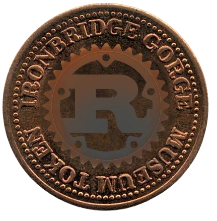

<div align="center">

</div>

<h1 align="center">A Secure Production Start Up (PPS) project</div>

 

 (Not yet created)


## Description
The only current purpose of this project is to make a REST api 
retrieve ```{"status":"ok"}```.

## Technologies
- Rust (The programming language)
- Rust API (A FastAPI inspired library)

## Instalation
Not yet posible

## Roadmap
- [ ] Add .gitignore
- [ ] Protect main branch
- [x] Add License
- [ ] Implement Dependabot
- [ ] Create API
